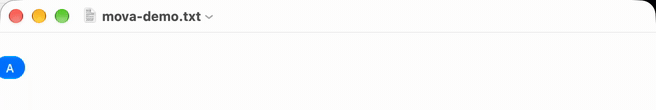
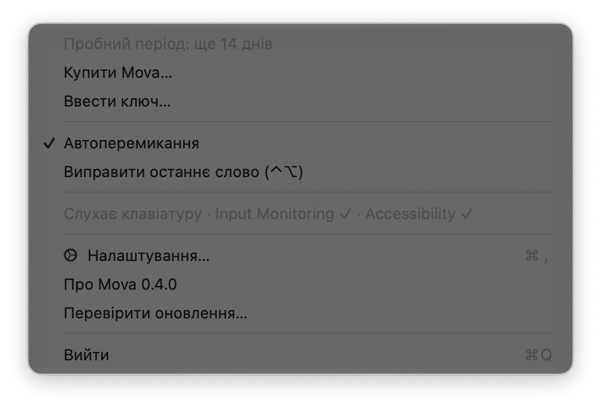
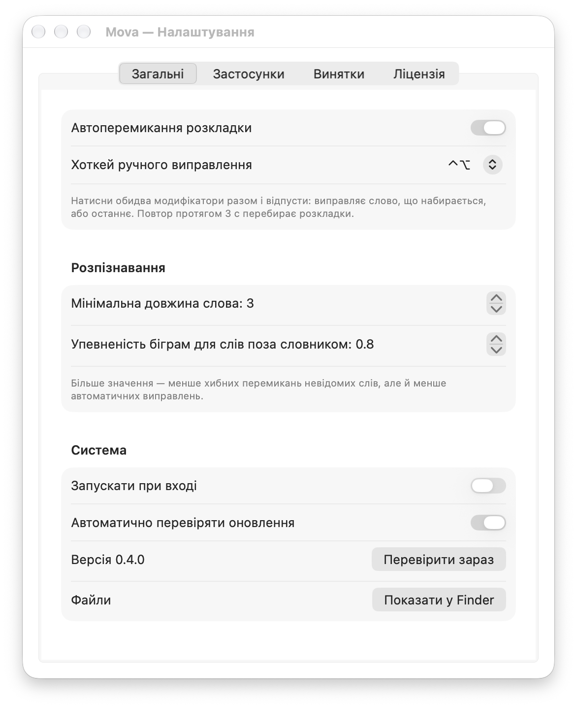
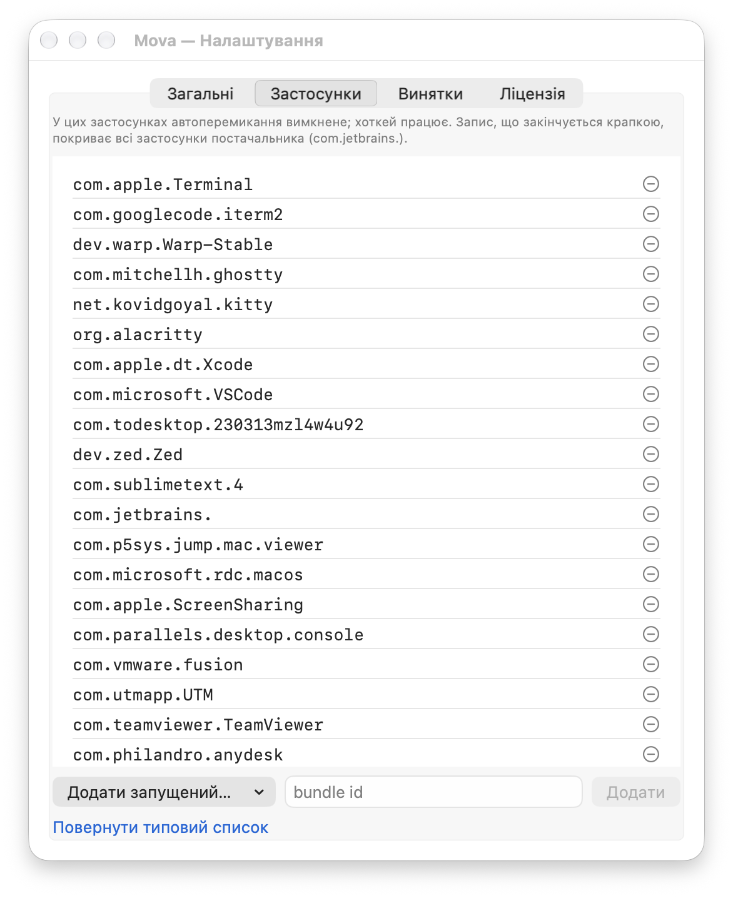
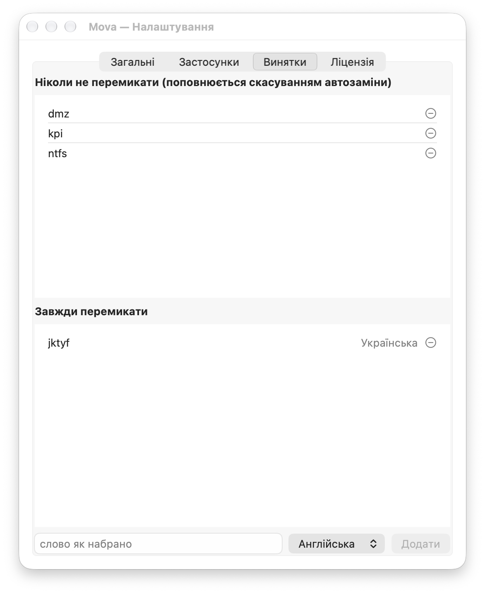
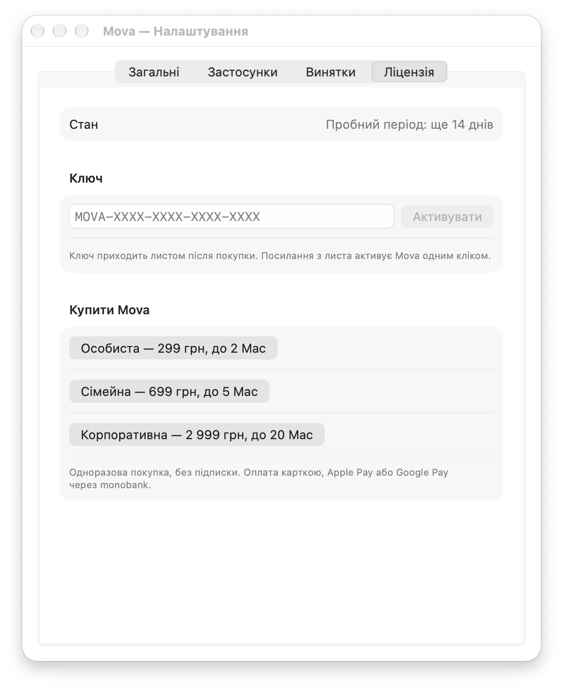

<h1 align="center">Mova</h1>

Набрали слово не в тій розкладці? Mova помітить це після пробілу, 
перемкне розкладку й перенабере слово. Англійська та українська, для macOS.

<a href="https://github.com/yuri-val/mova-releases/releases/latest/download/Mova.dmg"><b>Завантажити Mova.dmg</b></a>
 · <a href="https://mova.yuri-val.dev/">Сайт</a>

## Що вміє

- **Виправляє автоматично.** Після пробілу, Enter, Tab чи розділового
  знака Mova перевіряє слово. Якщо воно має сенс лише в іншій розкладці,
  Mova стирає його, перемикає розкладку і друкує правильно.
- **Розуміє незнайомі слова.** Спершу словник macOS, потім правила
  неможливих поєднань літер, а для слів поза словником (назви, жаргон)
  статистика пар літер. Короткі й сумнівні слова не чіпає.
- **Виправляє на вимогу.** Натисніть разом **⌃ Control + ⌥ Option** і
  відпустіть: Mova виправить слово, яке ви зараз набираєте, або останнє.
  Будь-якої довжини, навіть якщо автоматично не стала б.
- **Легко скасувати.** Той самий ⌃⌥ протягом 3 секунд після автозаміни
  повертає слово як було й запам’ятовує його: більше Mova його не
  чіпатиме.
- **Не заважає там, де не треба.** Термінали, редактори коду, віддалені
  робочі столи й віртуальні машини вимкнені за замовчуванням. У полях
  паролів Mova не працює ніколи.
- **Оновлюється сама.** Раз на добу перевіряє нову версію і показує її
  в меню. Вікно оновлення відкривається лише тоді, коли ви натиснете.

## Встановлення

1. Завантажте `Mova-<версія>.dmg` з
   [останнього релізу](https://github.com/yuri-val/mova-releases/releases/latest).
2. Відкрийте його й перетягніть **Mova** в **Applications**.
3. Запустіть Mova. У рядку меню з’явиться значок
   .
4. macOS попросить два дозволи в **System Settings → Privacy & Security**:
   - **Input Monitoring**: бачити натиснуті клавіші, щоб розпізнати слово;
   - **Accessibility**: стерти слово й надрукувати його в іншій розкладці.

   Увімкніть Mova в обох розділах. Перезапускати не треба: Mova підхопить
   дозвіл за кілька секунд.

Потрібна macOS 15 Sequoia або новіша й увімкнені в системі англійська та
українська розкладки, наприклад U.S. і Ukrainian-PC.

## Ціна і ліцензія

Mova працює повністю **14 днів безкоштовно**. Далі — одноразова покупка,
без підписки, з усіма оновленнями:

| Ліцензія | Ціна | Mac одночасно |
|---|---|---|
| Особиста | 299 грн | 2 |
| Сімейна | 699 грн | 5 |
| Корпоративна | 2999 грн | 20 |

[Купити на сайті](https://mova.yuri-val.dev/buy/): оплата карткою, Apple
Pay або Google Pay через monobank. Ключ з’являється на сторінці одразу
після оплати й приходить листом; посилання з листа активує Mova одним
кліком. Перехід на більшу ліцензію — доплата різниці, ключ той самий.
Повернення коштів протягом 14 днів без пояснень. Умови —
[публічна оферта](https://mova.yuri-val.dev/terms/).

## Меню

- Угорі — стан ліцензії: скільки днів пробного періоду лишилося або яка
  ліцензія активна, а також **Купити Mova…** і **Ввести ключ…**. В останні
  3 дні пробного періоду на значку з’являється крапка.
- **Автоперемикання** вмикає та вимикає автоматичні виправлення. Ручний
  ⌃⌥ працює завжди.
- **Виправити останнє слово** робить те саме, що хоткей.
- Рядок стану показує, чи Mova слухає клавіатуру і чи надано дозволи.
  Якщо ні, з’явиться пункт **Надати дозволи…**.

## Налаштування

- **Хоткей ручного виправлення**: ⌃⌥, ⌥⇧, ⌃⇧, ⌘⌥ або ⌃⌘.
- **Мінімальна довжина слова**: коротші слова автоматично не виправляються.
- **Упевненість біграм**: наскільки обережно виправляти слова, яких немає
  в словнику. Більше — менше хибних спрацювань.
- **Запускати при вході** та **Автоматично перевіряти оновлення**.

**Застосунки**, де автоперемикання вимкнене. Додайте запущений застосунок
зі списку або bundle ID вручну. Запис із крапкою в кінці
(`com.jetbrains.`) покриває всі застосунки постачальника. Ручний ⌃⌥ у
цих застосунках працює.

**Винятки** для окремих слів:
- **Ніколи не перемикати**: слова, які ви набираєте навмисно, наприклад
  абревіатури. Список поповнюється сам, коли ви скасовуєте автозаміну.
- **Завжди перемикати**: слова, які Mova не впізнає, але ви хочете, щоб
  виправляла, наприклад імена.

**Ліцензія**: стан, поле для ключа, покупка й перехід на більшу ліцензію.
Для активованої — **Оновити ліцензію** (одразу після апгрейду) і
**Деактивувати на цьому Mac**, щоб звільнити місце для іншого.

## Приватність

- Набраний текст нікуди не надсилається і не зберігається. Mova тримає в
  пам’яті лише поточне й останнє слово, щоб їх можна було виправити.
- У полях паролів (secure input) Mova не бачить клавіш.
- Мережа потрібна для перевірки оновлень у цьому репозиторії і раз на
  добу для ліцензії: Mova надсилає ключ і анонімний хеш Mac, з якого не
  можна відновити серійний номер. Без інтернету ліцензована Mova працює
  до 30 днів. Докладно — [політика конфіденційності](https://mova.yuri-val.dev/privacy/).
- Налаштування лежать у `~/Library/Application Support/Mova/`.

## Часті питання

**Mova нічого не виправляє.** Відкрийте меню: рядок стану має показувати
«Слухає клавіатуру» і дві галочки. Якщо галочки немає, увімкніть Mova в
Input Monitoring та Accessibility. Також перевірте, що застосунок не в
списку **Застосунки** і що ввімкнено **Автоперемикання**.

**Mova виправила слово, яке я хотів залишити.** Одразу натисніть ⌃⌥:
слово повернеться і більше не виправлятиметься.

**Mova не виправила слово.** Натисніть ⌃⌥, щоб виправити вручну. Якщо
таке слово трапляється часто, додайте його в **Завжди перемикати**.

**Хоткей конфліктує з іншою програмою.** Оберіть інший у налаштуваннях.

**Що буде після пробного періоду?** Mova перестане виправляти розкладку,
доки ви не введете ключ. Налаштування й винятки збережуться.

**Як перенести ліцензію на новий Mac?** Активуйте ключ на новому Mac.
Якщо місць немає, на старому натисніть **Ліцензія → Деактивувати на цьому
Mac** або зачекайте: Mac, що 30 днів не виходив на зв’язок, звільняє місце
сам.

**Загубили ключ?** [Відновіть його](https://mova.yuri-val.dev/recover/) за
email покупки.

**Як повернути кошти?** Протягом 14 днів після оплати напишіть на
support@yuri-val.dev з адреси покупки.

**Як видалити Mova?** Вийдіть через меню, перемістіть Mova з Applications
у кошик і за бажання видаліть `~/Library/Application Support/Mova/`.

## Цей репозиторій

Тут лише збірки ([Releases](https://github.com/yuri-val/mova-releases/releases)),
[журнал змін](CHANGELOG.md) і [`appcast.xml`](appcast.xml) для
автооновлення. Збірки підписані Developer ID і нотаризовані Apple,
оновлення підписані EdDSA.

---

### English

Mova is a keyboard layout auto-switcher for macOS, in the spirit of Punto
Switcher, for English and Ukrainian. Type a word in the wrong layout and
Mova notices after the space, switches the layout and retypes the word.
Press **⌃⌥** to fix the current or last word by hand, or to undo an
automatic fix within 3 seconds. Terminals, code editors and remote
desktops are excluded by default, and secure input fields are never
touched. Keystrokes stay on your Mac.
Requires macOS 15 or later. Free for 14 days, then a one-time purchase:
Personal 299 UAH (2 Macs), Family 699 UAH (5), Business 2999 UAH (20).
[Buy](https://mova.yuri-val.dev/en/buy/) ·
[Download Mova.dmg](https://github.com/yuri-val/mova-releases/releases/latest/download/Mova.dmg) · [Website](https://mova.yuri-val.dev/en/).
