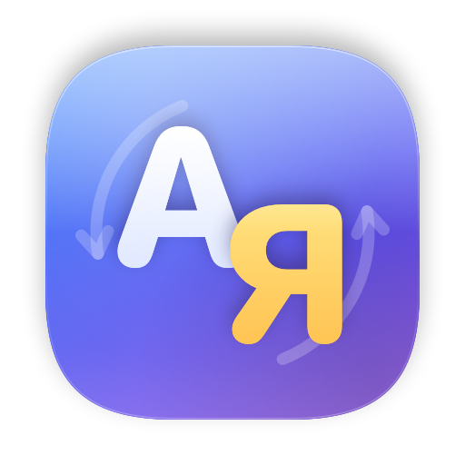

# Mova

Перемикач розкладки для macOS, як Punto Switcher: помічає, що слово набрано
не в тій розкладці, перемикає її і перенабирає слово. Українська, російська,
англійська.

**[Завантажити останню версію (.dmg)](https://github.com/yuri-val/mova-releases/releases/latest)**

- Розпізнає слово після пробілу чи розділового знака: словник macOS,
  правила неможливих поєднань, статистика біграм для слів поза словником.
- ⌃⌥ виправляє останнє слово вручну, повтор перебирає розкладки,
  те саме протягом 3 секунд скасовує автозаміну.
- Не втручається в терміналах, IDE, віддалених робочих столах, у полях
  паролів; список налаштовується.
- Оновлюється сама; вікно оновлення відкривається лише на ваш запит.

## Встановлення

macOS 15 або новіша. Відкрийте `.dmg`, перетягніть Mova в Applications,
запустіть. macOS попросить два дозволи в System Settings → Privacy & Security:

- **Input Monitoring** — бачити, які клавіші натиснуто, щоб розпізнати слово;
- **Accessibility** — стерти слово й надрукувати його в правильній розкладці.

Набраний текст не зберігається й нікуди не надсилається. Мережа потрібна
лише для перевірки оновлень цього репозиторію.

## Цей репозиторій

Тут лише збірки (Releases), [журнал змін](CHANGELOG.md) і
[`appcast.xml`](appcast.xml) для автооновлення. Збірки підписані Developer ID
і нотаризовані Apple; оновлення підписані EdDSA.

---

*Mova is a Punto Switcher–style keyboard layout auto-switcher for macOS
(Ukrainian, Russian, English). [Download the latest release](https://github.com/yuri-val/mova-releases/releases/latest).*
